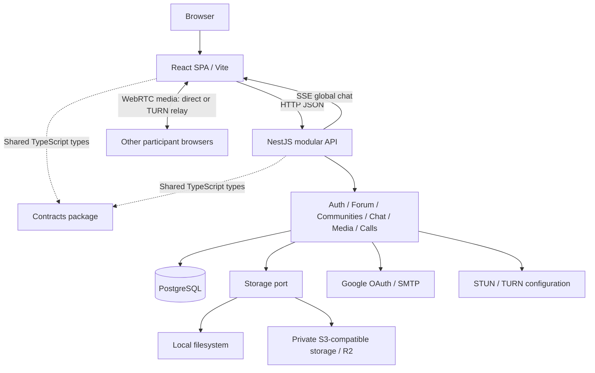

<div align="center">
  
  <h1>FORIS</h1>
  <p><strong>Chat & Enjoy</strong></p>
  <p>A community-driven platform for thoughtful discussions and real-time conversations.</p>
  <p>
    
    
    
    
    
    
    
  </p>
  <p><a href="#overview">Overview</a> · <a href="#features">Features</a> · <a href="#architecture">Architecture</a> · <a href="#getting-started">Getting started</a> · <a href="#documentation">Documentation</a></p>
</div>

---

## Overview

**FORIS** is a full-stack social discussion platform designed to bring structured, asynchronous conversations and immediate communication into a single experience. It provides a space to share questions, ideas and projects, discover people with common interests, build communities and connect through text or video.

Unlike a conventional forum, FORIS combines rich-text publishing, hierarchical content discovery, community membership, social interactions and real-time chat within a unified interface. Public content is available without an account, while verified members gain access to publishing, participation and private spaces subject to their permissions.

The project is built as a TypeScript monorepo, with a modular NestJS backend, a React frontend and shared API contracts. Its architecture emphasizes explicit access control, maintainable boundaries, consistent user experiences and portable infrastructure.

The application interface and system messages are currently in Spanish. This README is written in English for technical documentation and portfolio presentation.

## Features

### Forums and content discovery

- Public and community-scoped publications, organized through hierarchical topics and up to eight cross-cutting tags.
- Chronological **For You** and **Following** feeds; the latter combines followed authors and joined communities without bypassing privacy rules.
- Search and filters for posts, people, communities, topics, tags and authors, with URL-backed discovery state.
- Post editing, shareable links, upvotes and downvotes, pinned comments and nested discussions up to five levels below a root comment.
- Revision checks for edits, contextual drafts and recoverable submission failures.

### Rich-text publishing

The publishing canvas is powered by **Tiptap 3**. It supports headings, text formatting, lists, task lists, quotations, links, code, tables, text alignment and inline images with alternative text and captions. Authors can preview their content and recover tab-scoped drafts.

Posts are represented as validated structured documents, rendered through React elements rather than executing author-supplied HTML. By default, a publication supports up to three JPEG, PNG or WebP images of 5 MiB each. Comments and chat messages remain text-based.

### Communities and social relationships

- Create, discover and join public communities; private communities require valid invitations.
- Single-use invitation links with expiration and revocation.
- Community portraits, membership management, favorites and independent notification preferences.
- Private in-app notifications for new community publications.
- Public profiles, avatars, biographies and author following, with public-only content on profile pages.

### Chat and video calls

| Communication mode | Access | Delivery |
| --- | --- | --- |
| Global chat | Guests and verified accounts | Server-Sent Events (SSE) and persistent history |
| Community chat | Verified community members | Scoped history and background refresh |
| Direct messages | Verified accounts, subject to conversation access rules | Scoped history and background refresh |
| Video calls | Verified accounts with room access | WebRTC with server-coordinated signaling |

The global chat provides guest participation, message history, reconnect handling, idempotent sending and presence indicators. Presence distinguishes active accounts from guest browser identities; it is not a count of unique human beings.

Direct messaging supports initial outreach and an access-controlled conversation flow. Video calls support up to four verified accounts in global or community rooms and two in direct rooms. Users explicitly grant camera and microphone access, can minimize a call while continuing to chat and can leave without recording or storing call media.

### Accounts and authentication

- Email and password registration, one-time password (OTP) verification and password recovery.
- Google OAuth, account linking and unlinking, and session management.
- Public profile and private account settings, including avatar management.
- Terms acceptance and legal information pages.
- Guest participation without mandatory registration for the global text chat.

Real email delivery and Google sign-in require provider credentials. Video calling availability also depends on environment configuration.

## User experience and visual identity

<div align="center">
  
  
  
  
</div>

FORIS uses a reading-first visual language, with original mascot illustrations, a persistent application shell, responsive navigation, solid tonal surfaces and light, dark and system themes. The interface prioritizes content rather than a promotional landing page, and uses loading, empty and error states that reflect actual application data.

| Typeface | Purpose |
| --- | --- |
| Axiforma | Brand and headings |
| Plus Jakarta Sans | Primary reading and interface text |
| Fraunces | Editorial and expressive accents |
| SF Pro Display | Optional UI typography |

See [Brand guidelines](docs/brand.md) and the [frontend design specification](apps/web/DESIGN.md) for details.

## Technology stack

Versions below describe the declared dependency families, not a claim about the latest available releases.

| Layer | Technology | Responsibility |
| --- | --- | --- |
| Frontend | React 19, Vite 8 | Application UI and build tooling |
| Routing | React Router 7 | Client-side navigation |
| Styling | Tailwind CSS 4, shadcn/ui, Base UI / Radix UI | Components and responsive design |
| Editor | Tiptap 3, Shiki | Rich-text documents and code highlighting |
| Backend | NestJS 12, Express 5 | Modular HTTP API |
| Language | TypeScript 6 | Strict typing and shared contracts |
| Database | PostgreSQL 17, node-postgres (`pg`) | Persistence, transactions and migrations |
| Media | Sharp, AWS SDK for JavaScript v3 | Image validation and object storage |
| Storage | Local filesystem, S3-compatible storage / Cloudflare R2 | Environment-specific media adapters |
| Authentication | Google Auth Library, Nodemailer | OAuth and SMTP delivery |
| Communication | SSE, WebRTC, STUN/TURN | Chat updates and audio/video transport |
| Testing | Node.js test runner, Supertest, pg-mem, c8 | Unit tests, integration tests and coverage |
| Quality | ESLint, SonarQube | Static analysis and code quality reporting |
| Infrastructure | Docker Compose, Vercel Services | Local infrastructure and deployment configuration |

## Architecture

FORIS uses a **modular monolith**, rather than separate microservices. The API groups business capabilities into NestJS modules, while the frontend organizes UI and client behavior by feature. Shared TypeScript declarations define the boundary between them. PostgreSQL is accessed through parameterized SQL using `pg`, without introducing an ORM.



The backend coordinates call authorization and signaling; WebRTC handles audio and video transport. Image binaries live outside the database, while PostgreSQL stores their metadata, ownership and associations.

### Repository structure

```text
FORIS-Forum-Chat/
├── apps/
│   ├── api/                     # NestJS backend
│   │   ├── src/
│   │   │   ├── common/          # Errors, middleware and input validation
│   │   │   ├── config/          # Environment and provider configuration
│   │   │   ├── database/        # PostgreSQL, migrations and catalog seeds
│   │   │   ├── modules/
│   │   │   │   ├── auth/
│   │   │   │   ├── communities/
│   │   │   │   ├── conversations/
│   │   │   │   ├── forum/
│   │   │   │   ├── health/
│   │   │   │   ├── media/
│   │   │   │   ├── messages/
│   │   │   │   └── video-calls/
│   │   │   ├── application.ts
│   │   │   └── main.ts
│   │   └── test/                # Unit and integration tests
│   └── web/                     # React frontend
│       └── src/
│           ├── assets/          # Fonts and brand illustrations
│           ├── components/      # Shared UI and application providers
│           ├── features/        # Account, forum, communities, chat, etc.
│           ├── hooks/
│           ├── lib/
│           └── App.tsx
├── packages/
│   └── contracts/               # Shared TypeScript API declarations
├── docs/                        # Detailed technical documentation
├── scripts/                     # Setup, migrations, demo and quality tooling
├── .env.example
├── .env.development
├── compose.yaml
├── Dockerfile
├── package.json
├── sonar-project.properties
└── vercel.json
```

## Getting started

### Requirements

- Git and npm.
- Node.js compatible with the root `engines` field (`^22.22.3 || ^24.15.0 || >=26.0.0`). Node.js 24.15.0 or a newer compatible 24.x release is a suitable choice.
- Docker and Docker Compose v2 for the bundled PostgreSQL service, or an equivalent local PostgreSQL instance.
- SMTP and Google OAuth credentials only when testing the corresponding account flows.

### 1. Clone and install

```bash
git clone https://github.com/DavidJosueP2/FORIS-Forum-Chat.git
cd FORIS-Forum-Chat
npm ci
```

Run the remaining commands from the repository root. npm installs and links all workspaces through the root lockfile.

### 2. Prepare local environment variables

Linux/macOS (Bash):

```bash
cp .env.example .env
```

Windows (PowerShell):

```powershell
Copy-Item .env.example .env
```

For a fresh installation only: do not overwrite an existing `.env` that contains credentials. Then run:

```bash
npm run setup
npm run setup:auth
```

The setup scripts generate missing database passwords and the authentication secret without replacing existing non-empty values. Review `.env` before starting the application.

### 3. Start PostgreSQL

```bash
docker compose up -d app-db
npm run db:migrate
npm run db:seed:catalogs
```

The development profile expects PostgreSQL on port `5433` by default. If using a different instance, update the database environment variables accordingly. The API also has its own startup migration mechanism.

### 4. Start the application

```bash
npm run dev
```

| Service | Local address |
| --- | --- |
| Web application | http://127.0.0.1:5173 |
| API | http://127.0.0.1:3000/api |
| API health | http://127.0.0.1:3000/api/health |
| PostgreSQL | `127.0.0.1:5433` |
| SonarQube (optional) | http://127.0.0.1:9000 |

Open the web application using the exact origin configured in `APP_URL`. `localhost` and `127.0.0.1` are distinct browser origins. Vite proxies `/api` requests to the NestJS server.

### Optional: load demo content

FORIS includes a local demo dataset with fictional profiles, communities, posts, nested comments, votes and sample images.

```bash
npm run db:seed:demo -- --dry-run
npm run db:seed:demo
```

To enable password-based access for the documented demo account, configure `FORIS_DEMO_PASSWORD` privately before seeding. See [Demo data](docs/demo.md) for prerequisites, fixture credits and reset behavior. Demo tooling is intended for local development, not production databases.

## Environment configuration

Use [`.env.example`](.env.example) as the complete variable template. Never commit private credentials or place server secrets in `VITE_*` variables.

| Variable or group | Purpose |
| --- | --- |
| `HOST`, `APP_PORT` | Backend host and port |
| `PGHOST`, `PGPORT`, `PGDATABASE`, `PGUSER`, `PGPASSWORD` | PostgreSQL connection |
| `PGSSL` | PostgreSQL TLS setting (use `1` for the documented TLS deployment) |
| `APP_URL`, `TRUST_PROXY` | Public application origin and trusted proxy configuration |
| `AUTH_SECRET` | Server-side authentication and related cryptographic operations |
| `GOOGLE_CLIENT_ID`, `GOOGLE_CLIENT_SECRET` | Google OAuth credentials |
| `SMTP_*`, `MAIL_FROM`, `MAIL_FROM_ADDRESS` | Email verification and account recovery delivery |
| `STORAGE_DRIVER`, `STORAGE_LOCAL_ROOT` | Media adapter and local storage root |
| `S3_PROVIDER`, `S3_REGION`, `S3_BUCKET`, `S3_ENDPOINT` | S3-compatible object storage configuration |
| `S3_ACCESS_KEY_ID`, `S3_SECRET_ACCESS_KEY` | Private storage credentials |
| `MEDIA_*` | Upload limits, quotas, ticket expiry and cleanup |
| `CALLS_ENABLED`, `CALLS_STUN_URLS`, `CALLS_TURN_*` | WebRTC feature and connectivity configuration |
| `CALLS_CLOUDFLARE_TURN_*` | Cloudflare Realtime TURN credentials, when selected |
| `SONAR_PORT`, `SONAR_DB_PASSWORD`, `SONAR_TOKEN` | Optional SonarQube infrastructure and scanner authentication |

The development profile uses local disk storage at `.data/uploads`, so R2 credentials are not necessary for ordinary local development. Production requires private S3-compatible object storage. PostgreSQL configuration uses the separate `PG*` variables rather than `DATABASE_URL`.

Environment precedence in development, highest first: process variables, `.env.development.local`, `.env.development`, `.env.local`, `.env`. See [Development profiles](docs/development.md).

For Google OAuth, register the exact local callback `http://127.0.0.1:5173/api/auth/google/callback` where supported by the provider, and the exact HTTPS callback for production. Consult [Authentication](docs/authentication.md) for provider setup and origin requirements.

## API and application routes

The HTTP API uses the `/api` prefix. The following table is a selected reference, not an exhaustive API specification.

| Method | Endpoint | Purpose |
| --- | --- | --- |
| GET | `/api/health` | Application and database health |
| GET | `/api/posts` | Discover accessible posts |
| GET / POST | `/api/posts/:id/replies` | Read or create replies, subject to permissions |
| POST | `/api/posts` | Publish content |
| PATCH | `/api/posts/:id` | Edit an owned publication |
| PUT | `/api/posts/:id/vote` | Set or remove a post vote |
| GET | `/api/search` | Search accessible resources |
| GET / POST | `/api/messages` | Global chat history and sending |
| GET | `/api/events` | Global chat SSE stream |
| GET | `/api/conversations` | List authorized conversation rooms |
| GET / POST | `/api/conversations/:room/messages` | Scoped chat history and sending |
| POST | `/api/auth/register` | Native account registration |
| POST | `/api/auth/login` | Password authentication |
| GET | `/api/auth/session` | Current session |
| GET / POST | `/api/video-call` / `/api/video-call/join` | Call status and participation |

Public frontend routes include `/`, `/comunidades`, `/publicaciones/:postId`, `/personas/:userId` and `/chat`. Account and permission-dependent flows include `/publicar`, `/publicaciones/:postId/editar`, `/comunidades/crear`, `/notificaciones`, `/invitaciones/:token`, `/login`, `/profile` and scoped `/chat/:room` routes. Private resource access is enforced on the server, not merely by hiding UI controls.

## Security and privacy

Security is treated as part of the application's architecture, with controls implemented at the API, data and storage layers:

- **Identity and sessions:** server-resolved identities, HttpOnly cookies, verified-account requirements, expiring single-use OTPs and account linking safeguards.
- **Request integrity:** exact-origin checks, input validation, request limits, rate limiting and Helmet HTTP security middleware.
- **Authorization:** membership-based community access, authorship checks, verified-session requirements and scoped conversation permissions.
- **Database integrity:** parameterized SQL, transactions, migration history and idempotent request identifiers for retry-sensitive operations.
- **Content safety:** structured document validation, controlled rendering and image decoding/re-encoding with Sharp.
- **Media privacy:** private objects, time-limited upload/read permissions, quota enforcement and recoverable cleanup.
- **Video calls:** room access checks, temporary TURN credentials, explicit device consent and no application recording of call media.

These are implemented design controls, not a claim of independent security certification or a completed penetration test. A production rollout should additionally validate provider configuration, operational limits, backups, monitoring and abuse handling.

## Testing and code quality

```bash
npm run typecheck
npm run lint
npm test
# Run the combined verification workflow
npm run check
```

The backend test suite contains unit and integration tests for authentication-related flows, forum content, communities, conversations, media, database migrations, presence and video calls. Some integration tests cover actual PostgreSQL behavior; consult the test support configuration before running them. The coverage pipeline uses c8 and produces LCOV for SonarQube analysis.

To start the optional local SonarQube infrastructure:

```bash
docker compose up -d sonar-db sonarqube
```

After SonarQube is ready, configure a valid `SONAR_TOKEN` in `.env`, run tests to produce coverage, and run the scanner:

```bash
npm test
docker compose --profile analysis run --rm scanner
npm run sonar:report
```

The existing SonarQube project key is `messages-sonnar`. No coverage percentage or quality-gate result is claimed here without a current analysis run.

## Development commands

| Command | Purpose |
| --- | --- |
| `npm run dev` | Start API and web development servers |
| `npm run dev:api` / `npm run dev:web` | Start one development service |
| `npm run build` | Compile backend and frontend |
| `npm run build:api` / `npm run build:web` | Compile an individual application |
| `npm start` | Build and start the production API entrypoint |
| `npm run setup` / `npm run setup:auth` | Generate missing local configuration |
| `npm run db:migrate` | Apply pending local migrations |
| `npm run db:seed:catalogs` | Populate the topic/tag catalogs |
| `npm run db:seed:demo` | Populate local demo data |
| `npm run db:reset` | Inspect reset inventory; deletion requires explicit confirmation |
| `npm run sonar:report` | Retrieve configured SonarQube analysis reporting |

> [!CAUTION]
> Database reset and media cleanup can destroy local data. Review [the demo guide](docs/demo.md), stop active services and back up data before confirming any reset. Avoid running destructive tooling against shared or production resources.

## Deployment

The repository includes a Dockerfile and a Compose application profile, as well as a `vercel.json` configuration for Vercel Services. The latter declares independent build services for Vite and NestJS while routing `/api/*` to the backend on the same public origin.

```bash
npm run build
```

Build outputs are generated in `apps/api/dist` and `apps/web/dist`. For Vercel, the API-specific `build:vercel` script packages an explicit ESM entrypoint.

Production setup requires an HTTPS `APP_URL`, stable `AUTH_SECRET`, PostgreSQL connection settings, private object storage and the relevant OAuth/SMTP credentials. If calls are enabled, configure a supported TURN provider (Cloudflare Realtime or coturn REST). Keep media storage external to ephemeral deployment filesystems.

The Compose application profile is a starting point for containerized deployment; supply all mandatory production configuration to the container before using it. Verify `/api/health`, authentication, uploads, call connectivity and SSE behavior in the target runtime. Long-lived streams and background jobs need particular attention on serverless platforms.

See [Vercel deployment notes](docs/vercel.md) for packaging, origin handling and historical troubleshooting. A successful live deployment is not asserted in this README.

## Documentation

| Guide | Focus |
| --- | --- |
| [Product specification](PRODUCT.md) | Current product capabilities and constraints |
| [Architecture](docs/architecture.md) | Module boundaries and implementation structure |
| [Development](docs/development.md) | Local profiles and environment precedence |
| [Authentication](docs/authentication.md) | Sessions, OAuth and OTP email |
| [Forums](docs/forum.md) · [Editor](docs/editor.md) | Publishing, classification and rich-text documents |
| [Discovery](docs/discovery.md) · [Following](docs/following.md) | Search, feeds and social relationships |
| [Discussion](docs/discussion.md) | Replies, votes, pinning and editing |
| [Communities](docs/communities.md) | Membership, invitations and notifications |
| [Chat presence](docs/chat-presence.md) | Identity, activity and presence semantics |
| [Video calls](docs/video-calls.md) | WebRTC, signaling and TURN |
| [Media](docs/media.md) | Uploads, storage adapters and quotas |
| [Brand](docs/brand.md) | Typography and mascot identity |
| [Demo](docs/demo.md) | Development fixtures and data management |
| [Vercel](docs/vercel.md) | Deployment configuration |

Some guides describe earlier implementation stages. When they differ from newer functionality, refer to `PRODUCT.md` and the corresponding current source modules.

## Project status

FORIS is an evolving community and communication platform. The current codebase contains forum publishing and editing, public and private communities, authentication, social discovery, chat rooms, media storage and optional WebRTC calls.

Current scope excludes real-time collaborative editing, comprehensive moderator roles, chat file attachments, call recording and screen sharing. Potential future work includes moderation and abuse reporting, operational observability, broader automated UI coverage and scaling validation.

## Maintainer and licensing

Maintained by [DavidJosueP2](https://github.com/DavidJosueP2).

The repository does not currently provide a root license file, and the API package declares `UNLICENSED`. Public visibility does not itself grant permission to reuse or redistribute the project's source. Third-party dependencies, fonts and demo assets retain their respective licensing terms; consult their notices and [demo asset credits](scripts/demo/assets/credits.json).

---

<div align="center">
  <strong>FORIS — Chat & Enjoy</strong>
  <br />
  <sub>A space to share ideas, build communities and start meaningful conversations.</sub>
</div>
